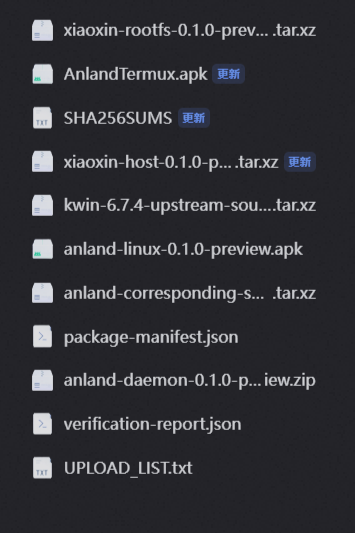
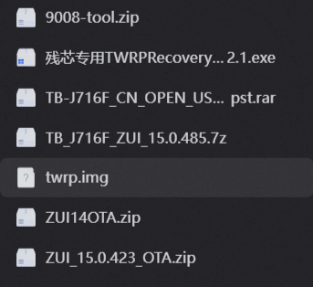
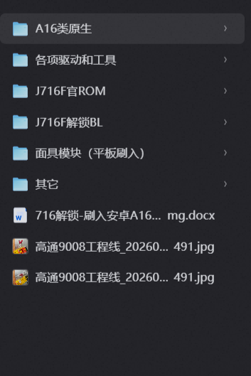

# 联想小新 Pad Pro 2021 (TB-J716F) 刷入 Arch Linux + KDE Wayland 桌面保姆级全流程教程

> **适用机型**：联想小新 Pad Pro 2021（型号 `TB-J716F`，骁龙 870）  
> **目标基线**：ZUI 15.0.485（Android 13） + Magisk Root + Arch Linux ARM (Chroot) + Anland (KDE Plasma 6 Wayland)  
> **方案亮点**：免编译内核、90Hz 丝滑 Wayland 桌面（Turnip/Zink Vulkan 硬件加速）、空闲 0 重绘省电优化、原生音频/按需麦克风零空转、前后双摄直通、Fcitx5 中文输入法（含纯终端内中文候选）、触控板自然滚动修正、KDE 桌面与 Termux 纯终端双模式无缝切换（任务持久不断线）。

---

## 目录

1. [夸克网盘资源汇总与文件说明](#一夸克网盘资源汇总与文件说明)
2. [第一阶段：解锁 Bootloader (BL 永久解锁与 ZUI 15 避坑)](#二第一阶段解锁-bootloader-bl-永久解锁与-zui-15-避坑)
3. [第二阶段：刷回 ZUI 15 官方包并获取 Magisk Root](#三第二阶段刷回-zui-15-官方包并获取-magisk-root)
4. [第三阶段：一键部署优化版 Arch Linux + KDE 桌面](#四第三阶段一键部署优化版-arch-linux--kde-桌面)
5. [第四阶段：配置 Termux 持久终端与日常使用技巧](#五第四阶段配置-termux-持久终端与日常使用技巧)
6. [常见问题与救砖回退指南](#六常见问题与救砖回退指南)
7. [AI Agent 全自动执行指南（供 AI 助手无 GUI 纯命令行执行）](#七ai-agent-全自动执行指南供-ai-助手无-gui-纯命令行执行)

---

## 一、夸克网盘资源汇总与文件说明

全流程所需的 **优化版 Arch Linux + KDE Wayland 桌面一键包**、**底层驱动**、**官方固件底包**、**BL 解锁文件** 与 **Magisk Root 镜像** 已全部通过以下 3 个夸克网盘链接分享：

### 1. 夸克网盘资源包一：「TB-J716F_ArchLinux_KDE桌面包」（Linux 桌面核心一键包）
- **链接**：[https://pan.quark.cn/s/1249631c0930](https://pan.quark.cn/s/1249631c0930)
- **提取码**：`rrv5`
- **手机端淘口令**（复制整段打开夸克 APP）：
  ```text
  /~9c6c3bPo8d~:/
  ```
- **包含内容预览**：
  
  - `xiaoxin-rootfs-0.1.0-preview.tar.xz`（约 1.31 GiB，解压后约 4.6 GiB）：已集成全部性能、渲染、音视频、输入法修复的干净 Arch Linux ARM 镜像（预设通用用户 `linux`）。
  - `xiaoxin-host-0.1.0-preview.tar.xz`：Android 端一键安装、首次身份初始化、挂载与模式切换脚本包。
  - `anland-daemon-0.1.0-preview.zip`：Magisk 显示与音频桥接守护模块。
  - `anland-linux-0.1.0-preview.apk`：深度修复版 Anland 客户端（修复音频线程空转、MMAP 占满 CPU、触控板横纵轴反转、5 秒闪屏等问题）。
  - `AnlandTermux.apk`：终端模式配套 Termux 客户端。
  - `anland-corresponding-source-0.1.0-preview.tar.xz` & `kwin-6.7.4-upstream-source.tar.xz`：GPLv3 合规对应源码包。
  - `SHA256SUMS` / `package-manifest.json` / `verification-report.json`：文件 SHA256 校验和与隐私脱敏校验报告。

### 2. 夸克网盘资源包二：「小新pad pro 2021相关」（官方底包与 9008 工具）
- **链接**：[https://pan.quark.cn/s/ba5e10d4736e](https://pan.quark.cn/s/ba5e10d4736e)
- **提取码**：`TNwf`
- **手机端淘口令**（复制整段打开夸克 APP）：
  ```text
  /~3a353bPmPP~:/
  ```
- **包含内容预览**：
  
  - `9008-tool.zip`：高通 9008 基础工具包
  - `TB-J716F_CN_OPEN_USER_Q00209.3_R_ZUI_12.6.211_ST_210730_qpst.rar`：**ZUI 12.6 降级线刷底包**（用于解锁 BL）
  - `TB_J716F_ZUI_15.0.485.7z`：**ZUI 15.0.485 官方 9008 线刷完整包**（最终主力底包，内置 `tool/` 刷机工具与引导）
  - `twrp.img` / `残芯专用TWRPRecovery...exe` / `ZUI14OTA.zip` / `ZUI_15.0.423_OTA.zip`（备用工具与 OTA 包）

### 3. 夸克网盘资源包三：「Android_A16_TB_J716F」（驱动、BL 解锁镜像与 Magisk Root）
- **链接**：[https://pan.quark.cn/s/5053a798cd6b](https://pan.quark.cn/s/5053a798cd6b)
- **提取码**：`S2BM`
- **手机端淘口令**（复制整段打开夸克 APP）：
  ```text
  /~82dc3bPnL5~:/
  ```
- **包含内容预览**：
  
  - `各项驱动和工具/`：
    - `高通9008驱动/QDLoader HS-USB Driver_64bit_Setup.exe`（电脑必装 9008 驱动）
    - `安装ADB驱动/` & `win_tools/`（含 `adb.exe`、`fastboot.exe`）
    - `安装QPST/QPST.2.7.496.1.exe`、`搞机通`、`柚坛工具箱`（9008 分区备份与读写工具）
  - `J716F解锁BL/`：
    - `img镜像文件夹（电脑）/fpinfo.img`、`persist.img`（借用已解锁设备的分区镜像，仅在解锁瞬间临时刷入）
    - `img镜像文件夹（电脑）/SN_HA1N55AV_oem_unlock.img`（匹配的官方解锁证书镜像）
    - `1-root教程（联想小新pad pro 2021）.mp4`、`拆机短接点-高通9008.png`、`注意事项.txt`
  - `J716F官ROM/`：
    - `TB_J716F_ZUI_15.0.485.7z` 与 `TB-J716F_CN_OPEN_USER_Q00209.3_R_ZUI_12.6.211_ST_210730_qpst.zip`
  - `面具模块（平板刷入）/` & `A16类原生/`：
    - `boot_magisk_patched-30700_JODuT.img`（针对 ZUI 15.0.485 预先修补好的 Magisk Root 引导镜像）
    - `Magisk-v30.7.apk`（面具管理器安装包）

---

## 二、第一阶段：解锁 Bootloader (BL 永久解锁与 ZUI 15 避坑)

> [!CAUTION]
> **开始前必读（核心避坑）**：
> 1. 解锁 Bootloader 会**清空平板内所有用户数据**，请务必提前备份重要文件。
> 2. **为什么不能在 ZUI 15 下直接解锁？**  
>    联想官方已关闭解锁文件申请，需采用“9008 临时替换 `fpinfo` + `persist` 刷入解锁文件 `sn.img`”的方案。但 **ZUI 15 阉割了 `fastboot flash unlock` 命令**，且未解锁状态下替换 `fpinfo`/`persist` 会导致 ZUI 15 无限重启。因此，**当前在 ZUI 15 的机器必须先通过 9008 降级到 ZUI 12.6 解锁，解锁成功后再刷回 ZUI 15！**

### 步骤 1：安装驱动并进入高通 9008 (EDL) 模式
先在电脑上安装网盘 `各项驱动和工具` 中的 **高通 9008 驱动** 和 **ADB 驱动**。随后可通过以下任一方式让平板进入 9008 模式：
- **方式 A（推荐，软件命令）**：平板开机状态下开启「开发者选项 -> USB 调试」，连电脑执行：
  ```powershell
  adb reboot edl
  ```
- **方式 B（按键硬件方式）**：平板**彻底关机**，按住**【音量 + 键】**不放，同时插入连接电脑的 USB 数据线（看到电脑设备管理器出现端口即可松手；也可使用高通 9008 工程线）。

打开 Windows「设备管理器 -> 端口 (COM 和 LPT)」，确认出现 **`Qualcomm HS-USB QDLoader 9008 (COMx)`**（记下你的端口号，例如 `COM5`）。

### 步骤 2：备份原机 `fpinfo` 与 `persist` 分区（极其重要！）
在修改任何分区前，先备份你平板自己的 `fpinfo` 和 `persist` 分区（内含原机序列号 SN 与传感器校准数据）：
1. 打开网盘 `各项驱动和工具` 中的 **QPST (QFIL)** 或 **搞机通**（加载 ZUI 15 解压包内的 `prog_firehose_ddr.elf` 引导文件，存储类型选 **`UFS`**）。
2. 打开分区管理器（Partition Manager），找到 **`fpinfo`**（1 MB）和 **`persist`**（32 MB）两个分区。
3. 右键读取/备份出来，重命名为 **`orig_fpinfo.img`** 和 **`orig_persist.img`**（若导出为 `.bin` 后缀直接改名为 `.img` 即可），保存在电脑安全位置，**切勿丢失**！

### 步骤 3：9008 降级刷入 ZUI 12.6 底包
如果平板当前是 ZUI 14 / ZUI 15，先在 9008 模式下刷入网盘中的 `TB-J716F_CN_OPEN_USER_Q00209.3_R_ZUI_12.6.211_ST_210730_qpst`：
- **图形界面方式（QFIL）**：打开 QFIL，选择 `Flat Build` / `Meta Build`，加载 `prog_firehose_ddr.elf` 与 ZUI 12.6 目录下的 `contents.xml`，右下角 Storage Type 选 **`UFS`**，点击 `Download` 刷入。
- **命令行方式**（使用 ZUI 15 `tool/` 目录下的工具）：
  ```powershell
  # 1. 注入 Sahara Firehose 引导（将 COM5 替换为你的实际端口号）
  QSaharaServer.exe -p \\.\COM5 -s 13:prog_firehose_ddr.elf

  # 2. 刷入解压后的 ZUI 12.6 固件目录
  fh_loader.exe --port=\\.\COM5 --search_path="你的ZUI12.6解压目录" --contentsxml="你的ZUI12.6解压目录\contents.xml" --setactivepartition=1 --memoryname=ufs --showpercentagecomplete --zlpawarehost=1 --noprompt --reset
  ```

### 步骤 4：9008 刷入借用的解锁分区 (`fpinfo.img` & `persist.img`)
刷完 ZUI 12.6 后，重新进入 **9008 模式**（拔线关机，按住【音量+】插线重新进入 9008），使用 QPST 分区管理器或搞机通，将网盘 `J716F解锁BL/img镜像文件夹（电脑）/` 下的 **`fpinfo.img`** 和 **`persist.img`** 刷入对应的 `fpinfo` 和 `persist` 分区。

### 步骤 5：进入 Fastboot 刷入 `sn.img` 完成永久解锁
1. 长按【电源键 + 音量减键】重启平板并进入 **Fastboot 模式**（屏幕显示绿色 `START` 字样）。
2. 打开网盘 `win_tools` 下的命令行（或使用 `柚坛工具箱`），依次执行以下解锁命令：
   ```powershell
   # 1. 刷入匹配的解锁证书镜像 (位于 J716F解锁BL/img镜像文件夹（电脑）/ 下)
   fastboot flash unlock SN_HA1N55AV_oem_unlock.img

   # 2. 执行永久解锁指令（平板会自动重启并清除数据）
   fastboot oem unlock-go
   ```
3. 再次按住【音量减键】回到 Fastboot，验证解锁状态：
   ```powershell
   fastboot getvar unlocked
   ```
   看到输出 **`unlocked: yes`**，恭喜你，Bootloader 已永久解锁！

### 步骤 6：恢复原机 `fpinfo` 与 `persist` 分区
解锁完成后，重新进入 **9008 模式**，用 QPST 分区管理器或搞机通将你在**步骤 2** 备份的 **`orig_fpinfo.img`** 和 **`orig_persist.img`** 刷回平板，恢复你自己的真实序列号（不会影响已解锁的 BL 状态）。

---

## 三、第二阶段：刷回 ZUI 15 官方包并获取 Magisk Root

### 步骤 1：9008 线刷回 ZUI 15.0.485 官方系统
由于我们的 Linux 环境与驱动适配基于 **ZUI 15.0.485（Android 13）**，现在在 9008 模式下刷回网盘中的 `TB_J716F_ZUI_15.0.485.7z`：
1. 解压 `TB_J716F_ZUI_15.0.485.7z`。
2. 确保平板处于全新握手的 **9008 模式**（拔线关机后，按住【音量+】插线连电脑）。
3. 直接双击运行解压目录下的 **`运行我，刷机.cmd`**（或使用 QFIL / `fh_loader.exe` 刷入 `image\contents.xml`）。
4. 刷入完成后平板自动重启，完成 ZUI 15 开机引导，进入系统后打开「设置 -> 我的一天/关于本机」，连续点击版本号 7 次开启「开发者选项」，并在「系统 -> 开发者选项」中打开 **USB 调试**。

### 步骤 2：Fastboot 刷入 Magisk 修补版 Boot 镜像
1. 电脑连接平板，重启到 Fastboot 模式：
   ```powershell
   adb reboot bootloader
   ```
2. 刷入网盘 `面具模块（平板刷入）/` 下的 **`boot_magisk_patched-30700_JODuT.img`**（同时刷入 A/B 槽位确保万无一失）：
   ```powershell
   fastboot flash boot_a boot_magisk_patched-30700_JODuT.img
   fastboot flash boot_b boot_magisk_patched-30700_JODuT.img
   fastboot reboot
   ```

### 步骤 3：安装 Magisk 管理器并验证 Root
1. 平板开机后，安装网盘 `A16类原生/` 下的面具 App：
   ```powershell
   adb install -r Magisk-v30.7.apk
   ```
2. 在平板桌面上打开 **Magisk** 应用（若弹窗提示“需要修复运行环境”，点击确定让它自动重启一次）。
3. 在电脑终端测试 Root 权限：
   ```powershell
   adb shell "su -c id"
   ```
   此时平板屏幕会弹出超级用户授权请求，勾选**「永久」**并点击**「允许」**。终端返回 `uid=0(root) gid=0(root)` 即代表 Root 完美就绪！

---

## 四、第三阶段：一键部署优化版 Arch Linux + KDE 桌面

本项目的 Release 镜像已内置全部底层调优（Zink+Turnip GPU 加速、KWin 损伤重绘修复、Anland 空闲帧等待防闪屏、PipeWire 音频与按需麦克风、前后双摄 I420 桥接、Fcitx5 中文输入法等），无需手动编译任何代码。

### 步骤 1：刷入 Magisk 显示守护模块 (`anland-daemon`)
1. 将模块推送到平板内部存储：
   ```powershell
   adb push anland-daemon-0.1.0-preview.zip /sdcard/Download/
   ```
2. 打开平板上的 **Magisk** -> 底部**「模块」** -> **「从本地安装」**，选择 `/sdcard/Download/anland-daemon-0.1.0-preview.zip` 刷入，完成后点击**「重启」**。

### 步骤 2：推送 Linux 安装包到平板
平板重启开机后，在电脑 PowerShell 中将 3 个核心安装文件推送到 `/data/local/tmp/`（请确保平板剩余存储空间大于 8 GB）：
```powershell
adb push xiaoxin-host-0.1.0-preview.tar.xz /data/local/tmp/
adb push xiaoxin-rootfs-0.1.0-preview.tar.xz /data/local/tmp/
adb push anland-linux-0.1.0-preview.apk /data/local/tmp/
```

### 步骤 3：执行一键安装脚本
1. 进入平板 ADB Root Shell 并解压宿主接入包：
   ```powershell
   adb shell
   ```
   在进入的 shell 中依次输入：
   ```sh
   su
   mkdir -p /data/local/tmp/xiaoxin-host
   /data/adb/magisk/busybox tar -xJpf /data/local/tmp/xiaoxin-host-0.1.0-preview.tar.xz -C /data/local/tmp/xiaoxin-host
   ```
2. 运行安装程序（会自动校验 SHA256、解压 rootfs 到 `/data/local/archlinux`、安装定制版 Anland 客户端 APK、生成全新的机器 ID 与 SSH 密钥）：
   ```sh
   sh /data/local/tmp/xiaoxin-host/install.sh --allow-permissive \
     /data/local/tmp/xiaoxin-rootfs-0.1.0-preview.tar.xz \
     75e4bece75f69249c1d7f457964ac5e7f18446e09a3976d68c0f2f6a64651ca3 \
     /data/local/tmp/anland-linux-0.1.0-preview.apk
   ```
3. **设置你的 Linux 密码**：安装脚本会在终端提示你为预设用户 `linux`（UID 1000，拥有 `sudo` 权限）输入两次新密码。
4. 安装完成后，可清理 `/data/local/tmp/xiaoxin-rootfs-0.1.0-preview.tar.xz` 释放 1.31 GB 临时空间：
   ```sh
   rm -f /data/local/tmp/xiaoxin-rootfs-0.1.0-preview.tar.xz
   ```

### 步骤 4：配置 Android 端 Anland 权限（仅首次需要）
在启动桌面之前，在 Android 端完成以下授权：
1. 打开 **Magisk** ->「超级用户」，确保 **Anland** 的 Root 权限处于开启状态。
2. 在 Android「设置 -> 应用管理 -> Anland -> 权限」中，授予 **麦克风** 和 **摄像头** 权限（用于 Linux 按需录音与浏览器视频通话）。
3. 在 Android「设置 -> 辅助功能（无障碍）」中，找到 **Anland** 并开启无障碍服务（用于支持外接物理键盘的 `Esc`、快捷键拦截与触控板手势）。

### 步骤 5：启动 KDE Plasma Wayland 桌面！
在 Root Shell 中执行启动脚本：
```sh
sh /data/adb/kde-desktop/bin/launch_kde_desktop.sh
```
平板会自动拉起 Anland 并进入 90Hz 的 **Arch Linux KDE Plasma Wayland 桌面**！

---

## 五、第四阶段：配置 Termux 持久终端与日常使用技巧

### 1. 接入 Termux 共享持久终端
1. 在平板上安装 Termux（可使用 Anland 配套 Termux 或常规 Termux）并打开一次等待初始化完成。
2. 在 ADB 或终端中执行一键绑定：
   ```sh
   su -c 'sh /data/local/tmp/xiaoxin-host/configure-termux.sh'
   ```
3. 之后每次打开 Termux，都会直接进入同一个 Arch Linux 环境，且与桌面里的 `Konsole` 终端共享同一个后台 `tmux` 会话池。

### 2. 桌面模式 vs 纯终端模式（一键省电切换）
在 Linux 终端内随时输入以下命令，或在 KDE 左下角应用菜单点击**「切换到终端模式」**：
```sh
# 关闭 KDE/Wayland 图形界面，释放 ~1.5GB 内存，转入 Termux 纯终端模式（后台任务不中断！）
linux-mode terminal

# 重新拉起 KDE Plasma Wayland 图形桌面
linux-mode desktop
```

### 3. 快捷键与输入法使用指南
- **桌面中文输入法（Fcitx5）**：按 `Ctrl + 空格` 或 `Shift` 切换中英文。
- **纯终端（Termux / Konsole）中文输入**：按 **`Ctrl + 空格`** 可直接在终端光标旁呼出中文拼音候选栏。
- **持久终端多任务管理（tmux）**：
  - 新建终端任务窗口：先按 `Ctrl + B`，松开后再按 `C`
  - 查看/切换所有后台任务窗口：先按 `Ctrl + B`，松开后再按 `W`
  - 即使你关掉 Konsole 窗口或退出 KDE 桌面，里面正在运行的编译、下载、AI CLI 任务依然在后台持续运行！

### 4. 开启/关闭开机自动进入 Linux 桌面
默认关闭开机自启（开机停留在 Android 桌面）。如需开机自动启动进入 Linux 桌面，可在 Android Root Shell 下执行：
```sh
# 开启开机自启
su -c 'sh /data/local/tmp/xiaoxin-host/set-autostart.sh on'

# 关闭开机自启
su -c 'sh /data/local/tmp/xiaoxin-host/set-autostart.sh off'
```

---

## 六、常见问题与救砖回退指南

1. **Q：在 Linux 里安装 Chromium / Chrome 浏览器打不开怎么办？**  
   **A**：由于 Android Chroot 内核命名空间限制，Chromium 系浏览器需要添加 `--no-sandbox` 参数启动。系统已内置 `/usr/local/bin/launch-browser` 包装器，通过该命令或桌面快捷方式启动即可。
2. **Q：如何连接代理？**  
   **A**：支持安装 Clash Verge Rev (`clash-verge-rev-bin`) 等 ARM64 客户端。注意：在 Chroot 环境下建议使用 **系统代理 / 端口代理（7897）**，不要强开 TUN 虚拟网卡模式；平时配置好节点后可关闭 Clash Verge 的图形窗口，仅保留后台 `verge-mihomo` 核心运行，可节省约 470 MB 内存与 45% 单核 CPU。
3. **Q：如果不小心改坏了 Linux 系统配置，如何回退到 Android？**  
   **A**：先执行 `su -c 'sh /data/local/tmp/xiaoxin-host/set-autostart.sh off'` 关闭自启，或直接切回 Android 桌面强行停止 Anland 应用即可；Android 原系统与 Linux 容器完全隔离，互不影响。
4. **Q：刷机过程中如果卡在 Fastboot 或无法开机怎么办？**  
   **A**：只要能长按【电源键 + 音量+】连电脑进入 **高通 9008 模式**，随时都可以按照[第二阶段步骤 1](#步骤-19008-线刷回-zui-150485-官方系统)重新刷入 ZUI 15.0.485 官方线刷包，100% 满血救砖恢复出厂状态。

---

## 七、AI Agent 全自动执行指南（供 AI 助手无 GUI 纯命令行执行）

如果你将本仓库与网盘文件交给 AI 编程助手（如 Antigravity / Claude Code / Cursor 等）代为全自动操作，AI 助手无需打开 QPST / 搞机通等图形界面，请直接遵循以下 **纯 CLI 规范与精确扇区参数**：

### 1. 自动识别高通 9008 端口 (Windows PowerShell)
```powershell
$port = Get-PnpDevice -Class Ports -PresentOnly |
  Where-Object { $_.FriendlyName -match '9008' -or $_.InstanceId -match '05C6' } |
  ForEach-Object { if ($_.FriendlyName -match '(COM\d+)') { $Matches[1] } } |
  Select-Object -First 1
```

### 2. Sahara 与 Firehose 协议状态机铁律（防死锁）
- **统一使用 ZUI 15 引导与工具**：始终使用 `TB_J716F_ZUI_15.0.485/tool/QSaharaServer.exe`、`fh_loader.exe` 以及 `TB_J716F_ZUI_15.0.485/image/prog_firehose_ddr.elf`。
- **单次会话仅注入一次 Sahara**：每次平板进入 9008 模式后，`QSaharaServer.exe` 只能成功执行**一次**。注入成功后设备即切换至 Firehose XML 协议。
- **执行 `fh_loader.exe` 前先用 `--nop` 探测**：
  ```powershell
  & $fh_loader --port=\\.\$port --nop --memoryname=ufs --zlpawarehost=1
  if ($LASTEXITCODE -ne 0) {
      & $sahara -p \\.\$port -s "13:$prog_firehose_ddr_elf"
      Start-Sleep -Seconds 2
  }
  ```

### 3. TB-J716F (UFS) 原机备份、解锁替换与恢复的精确 XML 模板
> [!IMPORTANT]
> Windows PowerShell 5.1 的 `-Encoding UTF8` 会写入 BOM 头（`EF BB BF`），导致 `fh_loader.exe` 解析 XML 失败。生成以下 XML 文件时**必须使用 `-Encoding ASCII`**！

1. **纯命令行备份原机 `persist` 与 `fpinfo` (`read_backup.xml`)**：
   ```xml
   <?xml version="1.0" ?>
   <data>
     <read SECTOR_SIZE_IN_BYTES="4096" filename="orig_persist.img" label="persist" num_partition_sectors="8192" physical_partition_number="0" start_sector="8"/>
     <read SECTOR_SIZE_IN_BYTES="4096" filename="orig_fpinfo.img" label="fpinfo" num_partition_sectors="256" physical_partition_number="0" start_sector="8712"/>
   </data>
   ```
   - 执行命令（注意：`--read` 导出的文件会保存在当前工作目录 `Cwd` 下）：
     ```powershell
     & $fh_loader --port=\\.\$port --sendxml="read_backup.xml" --search_path="$backupDir" --memoryname=ufs --showpercentagecomplete --zlpawarehost=1 --noprompt
     ```
   - **强制校验**：AI 必须确认 `orig_persist.img`（`33,554,432` 字节）和 `orig_fpinfo.img`（`1,048,576` 字节）均已生成且大小精确匹配，并立即备份至独立目录后，才允许继续下一步！

2. **纯命令行刷入解锁替换分区 (`write_unlock.xml`)**：
   ```xml
   <?xml version="1.0" ?>
   <data>
     <program SECTOR_SIZE_IN_BYTES="4096" file_sector_offset="0" filename="persist.img" label="persist" num_partition_sectors="8192" physical_partition_number="0" readbackverify="false" size_in_KB="32768.0" sparse="false" start_byte_hex="0x8000" start_sector="8"/>
     <program SECTOR_SIZE_IN_BYTES="4096" file_sector_offset="0" filename="fpinfo.img" label="fpinfo" num_partition_sectors="256" physical_partition_number="0" readbackverify="false" size_in_KB="1024.0" sparse="false" start_byte_hex="0x2208000" start_sector="8712"/>
   </data>
   ```
   - 执行命令：
     ```powershell
     & $fh_loader --port=\\.\$port --sendxml="write_unlock.xml" --search_path="$unlockImgDir" --memoryname=ufs --showpercentagecomplete --zlpawarehost=1 --noprompt
     ```

3. **纯命令行恢复原机分区 (`restore_orig.xml`)**：
   ```xml
   <?xml version="1.0" ?>
   <data>
     <program SECTOR_SIZE_IN_BYTES="4096" file_sector_offset="0" filename="orig_persist.img" label="persist" num_partition_sectors="8192" physical_partition_number="0" readbackverify="false" size_in_KB="32768.0" sparse="false" start_byte_hex="0x8000" start_sector="8"/>
     <program SECTOR_SIZE_IN_BYTES="4096" file_sector_offset="0" filename="orig_fpinfo.img" label="fpinfo" num_partition_sectors="256" physical_partition_number="0" readbackverify="false" size_in_KB="1024.0" sparse="false" start_byte_hex="0x2208000" start_sector="8712"/>
   </data>
   ```
   - 执行命令：
     ```powershell
     & $fh_loader --port=\\.\$port --sendxml="restore_orig.xml" --search_path="$backupDir" --memoryname=ufs --showpercentagecomplete --zlpawarehost=1 --noprompt
     ```

### 4. AI 非交互式安装 Linux 镜像 (`install.sh` 无 TTY 处理)
`install.sh` 最后一步执行的 `/usr/local/bin/firstboot-linux` 默认要求交互式 TTY（`[[ -t 0 ]]`）以运行 `passwd linux`。当 AI 通过后台非交互式 `adb shell` 执行时：
1. 若 `install.sh` 在最后一步因无 TTY 退出，镜像与宿主脚本实际上已全部部署完成；
2. AI 只需紧接着按顺序执行以下两条非交互式初始化命令即可完成收尾：
   ```powershell
   # 1. 生成 machine-id、SSH 密钥与 Pacman 密钥环（跳过交互式 passwd）
   adb shell "su -c 'chroot /data/local/archlinux /usr/bin/env PATH=/usr/local/sbin:/usr/local/bin:/usr/bin:/bin /usr/local/bin/firstboot-linux --prepare-only'"

   # 2. 为 linux 用户非交互式设置密码（请将 NEW_PASSWORD 替换为用户指定的密码）
   adb shell "su -c 'printf \"linux:NEW_PASSWORD\n\" | chroot /data/local/archlinux /usr/bin/chpasswd'"
   ```
3. 随后直接通过命令启动 KDE 桌面：
   ```powershell
   adb shell "su -c 'sh /data/adb/kde-desktop/bin/launch_kde_desktop.sh'"
   ```

